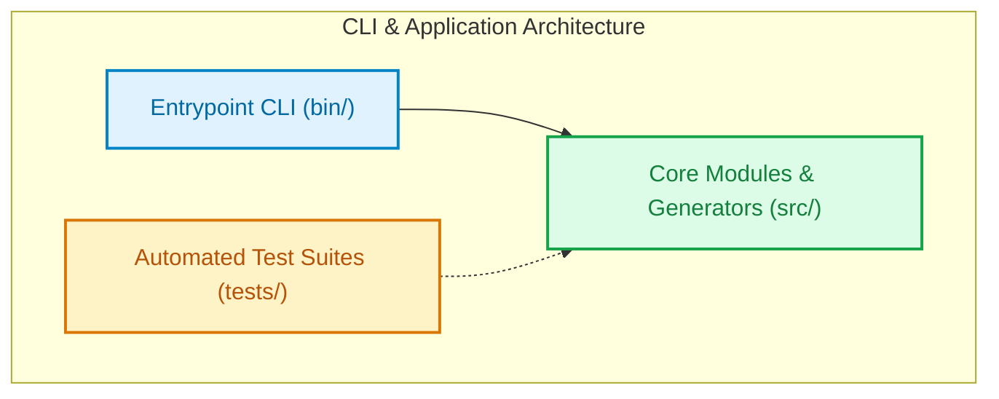

# 🏛️ Architecture Overview: larats

> Auto-generated by **[LaraTS CLI](https://github.com/SidiqFatuh187/Larats)**.  
> **100% Local & Safe:** Generated entirely in offline mode via local filesystem manifest & structure analysis. Zero data transmitted.

---

## 📌 Project Summary

| Attribute | Details |
| :--- | :--- |
| **Project Name** | `larats` |
| **Project Type** | **TYPESCRIPT** |
| **Detected Stack** | `TypeScript (TypeScript)` |
| **Scanned Files** | `27` files indexed (safe ignore filter applied) |

---

## 📊 Architectural Components Statistics

| Component Layer | Count | Description | Sample Files |
| :--- | :---: | :--- | :--- |
| **Controllers** | `0` | HTTP request handlers and response dispatchers | - |
| **Services** | `0` | Core domain logic and application workflows | - |
| **Repositories** | `0` | Data access abstraction and database queries | - |
| **Routes** | `0` | API endpoint mappings and router handlers | - |
| **DTOs & Schemas** | `0` | Data transfer objects and request validation schemas | - |
| **Models & Entities** | `0` | Database schema definitions and entity declarations | - |
| **Source Files** | `8` | Main application source code | `src/detector.ts`, `src/env.d.ts`, `src/index.ts` *(+5 more)* |
| **Test Files** | `9` | Automated test suites and specifications | `tests/detector.test.ts`, `tests/markdown.test.ts`, `tests/p0_features.test.ts` *(+6 more)* |

---

## 🗺️ Visual Architecture Flowchart

Visual representation of the project layers and request lifecycle rendered with [Mermaid.js](https://mermaid.js.org/):



---

## 🌲 Directory Structure Tree

Clean, high-level directory tree showing key folders (ignoring build artifacts, vendor files, and sensitive keys):

```text
├── scripts/
│   ├── gen-sample.ts
│   └── run-tests.mjs
├── src/
│   ├── generator/
│   │   ├── markdown.ts
│   │   └── scaffolder.ts
│   ├── templates/
│   │   ├── laravel.ts
│   │   └── typescript.ts
│   ├── detector.ts
│   ├── env.d.ts
│   ├── index.ts
│   └── scanner.ts
├── tests/
│   ├── detector.test.ts
│   ├── markdown.test.ts
│   ├── p0_features.test.ts
│   ├── p0_scanner.test.ts
│   ├── p1.test.ts
│   ├── p1_cli.test.ts
│   ├── scaffolder.test.ts
│   ├── scanner.test.ts
│   └── ... (1 more files/folders)
├── ARCHITECTURE.md
├── CHANGELOG.md
├── LICENSE
├── README.md
├── package.json
├── tsconfig.check.json
├── tsconfig.json
└── tsup.config.ts
```

---

## 🔒 Security & Privacy Notice

This architectural map was produced with strict privacy guarantees:
- **Zero Network Transmission:** Executed locally without telemetry, tracking, or outbound communication.
- **Safe Exclusion Filter:** Automatically ignores sensitive files and secret patterns (`**/node_modules/**`, `**/vendor/**`, `**/.pnpm/**`, `**/.yarn/**`, `**/.git/**`, `**/.svn/**`, `**/.hg/**`, `**/storage/**`, etc.) including `node_modules`, `vendor`, `.env*`, private keys, secrets, credentials, cloud configs, and cache folders.
- **Manifest & Structure Only:** Safely reads standard manifest dependencies (`package.json` / `composer.json`) to determine framework types, and relative file paths to categorize components. Never reads private configurations or file contents.

*Generated with ❤️ by LaraTS CLI.*
