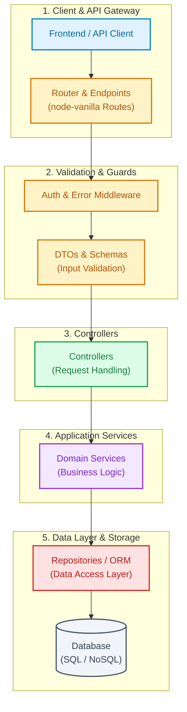

# 🏛️ Architecture Overview: archmind

> Auto-generated by **[ArchMind CLI](https://github.com/archmind-cli)** on `2026-10-24 05:18:54 UTC`.  
> **100% Local & Safe:** Generated entirely in offline mode via local filesystem metadata analysis. Zero data transmitted.

---

## 📌 Project Summary

| Attribute | Details |
| :--- | :--- |
| **Project Name** | `archmind` |
| **Project Type** | **TYPESCRIPT** |
| **Detected Stack** | `TypeScript (TypeScript)` |
| **Scanned Files** | `16` files indexed (safe ignore filter applied) |
| **Scan Duration** | `22 ms` |

---

## 📊 Architectural Components Statistics

| Component Layer | Count | Description | Sample Files |
| :--- | :---: | :--- | :--- |
| **Controllers** | `0` | HTTP request handlers and response dispatchers | -  |
| **Services** | `0` | Core domain logic and application workflows | -  |
| **Repositories** | `0` | Data access abstraction and database queries | -  |
| **Routes** | `0` | API endpoint mappings and router handlers | -  |
| **DTOs & Schemas** | `0` | Data transfer objects and request validation schemas | -  |
| **Models & Entities** | `0` | Database schema definitions and entity declarations | -  |

---

## 🗺️ Visual Architecture Flowchart

Visual representation of the project layers and request lifecycle rendered with [Mermaid.js](https://mermaid.js.org/):



---

## 🌲 Directory Structure Tree

Clean, high-level directory tree showing key folders (ignoring build artifacts, vendor files, and sensitive keys):

```text
├── src/
│   ├── generator/
│   │   ├── markdown.ts
│   │   └── scaffolder.ts
│   ├── templates/
│   │   ├── laravel.ts
│   │   └── typescript.ts
│   ├── detector.ts
│   ├── index.ts
│   └── scanner.ts
├── tests/
│   ├── detector.test.ts
│   ├── markdown.test.ts
│   ├── scaffolder.test.ts
│   └── scanner.test.ts
├── LICENSE
├── package.json
├── README.md
├── tsconfig.json
└── tsup.config.ts
```

---

## 🔒 Security & Privacy Notice

This architectural map was produced with strict privacy rules:
- **Zero Network Transmission:** Executed locally without telemetry or outbound communication.
- **Safe Exclusion Filter:** Ignored `node_modules`, `vendor`, `.env*`, key files, credentials, and cache folders.
- **Metadata Only:** Scanned file names and relative paths only; no secrets or private business contents were extracted.

*Generated with ❤️ by ArchMind CLI.*
