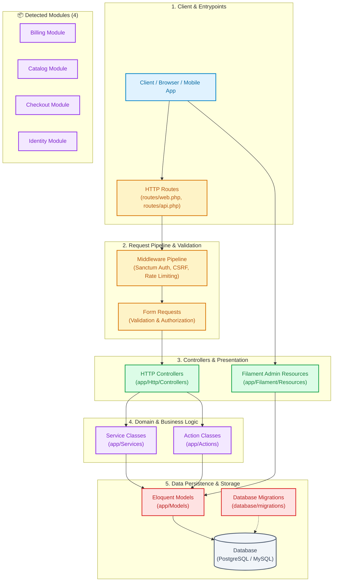

# 🏛️ Architecture Overview: E-Commerce Modular Platform

> Auto-generated by **[LaraTS CLI](https://github.com/SidiqFatuh187/Larats)**.  
> **100% Local & Safe:** Generated entirely in offline mode via local filesystem manifest & structure analysis. Zero data transmitted.

---

## 📌 Project Summary

| Attribute | Details |
| :--- | :--- |
| **Project Name** | `ecommerce-platform` |
| **Project Type** | **LARAVEL** |
| **Detected Stack** | `Laravel 12.0 (Filament, Livewire, Sanctum, Modular Architecture)` |
| **Scanned Files** | `142` files indexed (safe ignore filter applied) |
| **Scan Duration** | `32 ms` |

---

## 📊 Architectural Components Statistics

| Component Layer | Count | Description | Sample Files |
| :--- | :---: | :--- | :--- |
| **Eloquent Models** | `8` | Database entity mappings and business logic models | `app/Models/User.php`, `app/Models/Order.php`, `app/Models/Payment.php` *(+5 more)* |
| **HTTP Controllers** | `6` | Request handling and response orchestration | `app/Http/Controllers/OrderController.php`, `app/Http/Controllers/PaymentController.php`, `app/Http/Controllers/ProductController.php` *(+3 more)* |
| **Service Classes** | `5` | Encapsulated business logic and external integrations | `app/Services/OrderService.php`, `app/Services/PaymentService.php`, `app/Services/InventoryService.php` *(+2 more)* |
| **Action Classes** | `4` | Single-responsibility invokable operations | `app/Actions/CreateOrderAction.php`, `app/Actions/ProcessPaymentAction.php`, `app/Actions/GenerateInvoiceAction.php` *(+1 more)* |
| **Form Requests** | `6` | Input validation and authorization rules | `app/Http/Requests/StoreOrderRequest.php`, `app/Http/Requests/ProcessPaymentRequest.php`, `app/Http/Requests/ProductRequest.php` *(+3 more)* |
| **Filament Admin Resources** | `3` | Admin panel CRUD pages, widgets, and schemas | `app/Filament/Resources/OrderResource.php`, `app/Filament/Resources/ProductResource.php`, `app/Filament/Resources/UserResource.php` |
| **Routing Definitions** | `4` | Web, API, and console endpoint routes | `routes/web.php`, `routes/api.php`, `routes/console.php` *(+1 more)* |
| **Database Migrations** | `9` | Schema version control and table definitions | `database/migrations/2026_01_01_000000_create_users_table.php`, `database/migrations/2026_01_02_000000_create_orders_table.php` *(+7 more)* |

---

## 📦 Detected Modules & Domains (4)

This project organizes features into modular domains:

- **`Billing`** (Payment gateways, invoices, transaction history)
- **`Catalog`** (Products, categories, inventory management)
- **`Checkout`** (Cart calculation, promotions, order submission)
- **`Identity`** (Authentication, Sanctum tokens, user profiles)

---

## 🗺️ Visual Architecture Flowchart

Visual representation of the project layers and request lifecycle rendered with [Mermaid.js](https://mermaid.js.org/):



---

## 🌲 Directory Structure Tree

Clean, high-level directory tree showing key folders (ignoring build artifacts, vendor files, and sensitive keys):

```text
app/
├── Actions/
│   ├── CreateOrderAction.php
│   └── ProcessPaymentAction.php
├── Filament/
│   └── Resources/
│       ├── OrderResource.php
│       └── ProductResource.php
├── Http/
│   ├── Controllers/
│   │   ├── OrderController.php
│   │   └── PaymentController.php
│   └── Requests/
│       └── StoreOrderRequest.php
├── Models/
│   ├── Order.php
│   ├── Payment.php
│   └── User.php
├── Modules/
│   ├── Billing/
│   ├── Catalog/
│   └── Checkout/
└── Services/
    ├── OrderService.php
    └── PaymentService.php
database/
└── migrations/
    ├── 2026_01_01_000000_create_users_table.php
    └── 2026_01_02_000000_create_orders_table.php
routes/
├── api.php
├── console.php
└── web.php
```

---

## 🔒 Security & Privacy Notice

This architectural map was produced with strict privacy guarantees:
- **Zero Network Transmission:** Executed locally without telemetry, tracking, or outbound communication.
- **Safe Exclusion Filter:** Ignored `node_modules`, `vendor`, `.env*`, key files, credentials, and cache folders.
- **Manifest & Structure Only:** Safely reads standard manifest dependencies (`package.json` / `composer.json`) to determine framework types, and relative file paths to categorize components. Never reads private configurations or file contents.

*Generated with ❤️ by LaraTS CLI.*
